  <picture>
    <source media="(prefers-color-scheme: dark)" srcset="https://raw.githubusercontent.com/SathwikGoundla/SathwikGoundla/main/dark.svg">
    <source media="(prefers-color-scheme: light)" srcset="https://raw.githubusercontent.com/SathwikGoundla/SathwikGoundla/main/light.svg">
    
  </picture>

  
  
  

<h2 align="center">📊 GitHub Analytics</h2>

  <picture>
    <source media="(prefers-color-scheme: dark)" srcset="https://github-readme-stats-pi-wheat-38.vercel.app/api?username=SathwikGoundla&show_icons=true&hide_rank=true&theme=github_dark&hide_border=true">
    <source media="(prefers-color-scheme: light)" srcset="https://github-readme-stats-pi-wheat-38.vercel.app/api?username=SathwikGoundla&show_icons=true&hide_rank=true&theme=default&hide_border=true">
    
  </picture>
  <picture>
    <source media="(prefers-color-scheme: dark)" srcset="https://github-readme-stats-pi-wheat-38.vercel.app/api/top-langs?username=SathwikGoundla&layout=compact&theme=github_dark&hide_border=true">
    <source media="(prefers-color-scheme: light)" srcset="https://github-readme-stats-pi-wheat-38.vercel.app/api/top-langs?username=SathwikGoundla&layout=compact&theme=default&hide_border=true">
    
  </picture>

<h2 align="center">🐍 Contribution Graph</h2>

  <picture>
    <source media="(prefers-color-scheme: dark)" srcset="https://raw.githubusercontent.com/SathwikGoundla/SathwikGoundla/gh-pages/github-contribution-grid-snake-dark.svg">
    <source media="(prefers-color-scheme: light)" srcset="https://raw.githubusercontent.com/SathwikGoundla/SathwikGoundla/gh-pages/github-contribution-grid-snake.svg">
    
  </picture>

<h2 align="center">🛠️ Tech Stack</h2>

  
  
  
  
  
  
  
  
  
  

  <b>AI/ML • Deep Learning • NLP • RAG • Vector DB • Agentic AI • Prompt Engineering</b>

  <i>Building intelligent systems, experimenting with AI, and turning ideas into working products.</i>

